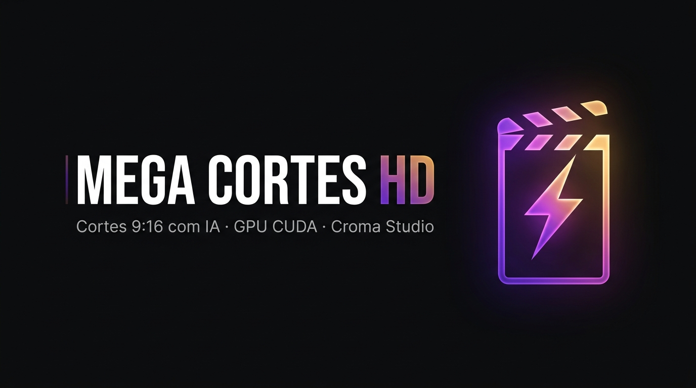

<p align="center">
  
</p>

# Mega Cortes HD

**Fork independente mantido por [PixelDust64](https://github.com/PixelDust64)** · [Baixar Releases](https://github.com/PixelDust64/cortador-automatico/releases)

> **Aviso de independência e créditos:** o **Mega Cortes HD** é uma **versão independente da comunidade**, derivada do código aberto (licença [MIT](LICENSE)) do projeto original criado por **Gabriel Workspace** ([gabrielworkspace/cortador-automatico](https://github.com/gabrielworkspace/cortador-automatico) · [@gabriel.workspace](https://www.instagram.com/gabriel.workspace/)).
> Este fork **não é oficial** e **não é afiliado, mantido ou endossado por Gabriel Workspace**, mas permanece **100% compatível** com os projetos, pastas e formatos da versão original.
> Para a versão oficial assinada digitalmente, acesse: [gabrielworkspace.github.io/cortador-automatico](https://gabrielworkspace.github.io/cortador-automatico/).

---

Corta vídeo e live da **Kick, Twitch e YouTube** em clipes verticais (**9:16**) prontos para TikTok, Reels e Shorts — tanto **live gravada (VOD)** quanto **ao vivo agora** — e inclui o **Croma Studio** integrado para criar thumbnails, banners e marcas d'água no mesmo lugar.

Tudo roda localmente no seu PC: nenhuma conta, chave de API ou mensalidade. A internet só é usada para baixar o vídeo (`yt-dlp`) e, opcionalmente, ler o chat público da live.

Guia de uso detalhado: [LEIA-ME.txt](LEIA-ME.txt).

## Diferenciais desta versão (Mega Cortes HD)

- **Uso adaptativo de GPU (CUDA + NVENC / AMF / QSV):** detecta em paralelo e de forma independente todos os recursos de hardware disponíveis no seu PC.
  - Acelera a **transcrição (`faster-whisper` / `ctranslate2`)** e a **separação de voz (`demucs`)** via **CUDA**, escolhendo automaticamente o `compute_type` suportado pela placa (`float16` em GPUs mais novas, `int8_float32` em arquiteturas Pascal `sm_61` como GTX 10xx), com fallback automático para CPU.
  - **FFmpeg fixado na versão `8.0.1`** (NVENC API `13.0`), mantendo compatibilidade com drivers NVIDIA `570+` / `582.xx` (inclusive série GTX 10xx / Pascal).
  - Nos **Ajustes**, exibe em uma linha direta a GPU detectada e as siglas ativas de transcrição e corte (`CUDA`/`CPU` e `NVENC`/`AMF`/`QSV`/`CPU`).
- **Croma Studio integrado (aba própria na barra superior):** função simples e direta para criar **thumbnails e banners para YouTube** e **materiais adicionais para criação de canais** (marcas d'água `150×150`, fundos em gradiente, padrões geométricos e tipografia editável) — carregado sob demanda, sem pesar na abertura do programa.

## Croma Studio — Thumbnails, banners e materiais para criação de canais

Além de gerar os cortes verticais, o **Mega Cortes HD** traz o **Croma Studio** embutido como uma segunda aba no topo do programa para agilizar a identidade visual do seu canal sem precisar abrir editores pesados:

- **Thumbnails para YouTube (`2048×1152`)** com tipografia editável, camadas de texto e exportação rápida.
- **Banners de canal (`2560×1440`)** já no formato recomendado do YouTube.
- **Marcas d'água (`150×150`)** prontas para aplicar nos vídeos do canal.
- **Materiais adicionais para criação de canais:** fundos em gradiente em alta resolução, padrões geométricos e presets prontos para Reels, Shorts, TikTok e YouTube (exportação em PNG, JPEG e BMP, 100% offline no próprio PC).

## Dois modos de corte

**Vídeo gravado** — baixa o VOD (ou usa um arquivo local), transcreve com Whisper local (GPU CUDA ou CPU), identifica os melhores trechos, corta em 9:16 com gancho e legenda e dá nota a cada clipe. Projetos ficam editáveis para ajustar começo/fim, reescrever o gancho ou extrair mais cortes.

**Ao vivo agora** — feito para postar primeiro:

1. **Gravação contínua**: o `yt-dlp` localiza a transmissão e o `ffmpeg` grava em pedaços de 4 s sem recodificar (descartando anúncios na Twitch), mantendo buffer dos últimos 20 minutos.
2. **Detecção leve**: taxa de mensagens do chat (Twitch IRC anônimo / Kick) e pico de volume comparados com a mediana recente.
3. **Conectar → configurar → Começar a clipar**: com prévia do enquadramento em tempo real; **CLIPAR AGORA** (tecla `C`) corta os últimos N segundos.
4. **Render rápido** (`x264 veryfast` ou GPU) direto dos pedaços, seguido de transcrição do clipe para sugerir título e hashtags.

## Texto fixo na tela

Nos dois modos dá para adicionar um texto fixo em todo clipe (topo, meio ou baixo; clipe inteiro ou só os 5 primeiros segundos; branco ou amarelo), usando `/` para quebrar linha e com visualização na prévia.

## Rodar a partir do código

```bash
iniciar.bat            # Windows: abre a janela do programa
node src/server.js     # ou direto (porta 4321)
```

Requer Node 22+, `ffmpeg`, `yt-dlp` e Python com `faster-whisper` (`instalar.bat` configura tudo). Sem `DADOS` definido, os arquivos vão para `D:\CortadorAutomatico` quando o disco `D:` existe.

## Código

| Arquivo | O que faz |
|---|---|
| `src/server.js` | servidor local, rotas `/api/*` e rota estática `/croma/` |
| `src/desempenho.js` | modos leve/total e detecção paralela de GPU (NVENC/AMF/QSV e CUDA) |
| `src/aovivo.js` | gravação da live, chat, detecção, corte e título dos clipes ao vivo |
| `src/pipeline.js` | vídeo gravado: transcrição → escolha → clipes |
| `src/score.js` / `src/copy.js` | pontuação dos trechos, títulos e hashtags |
| `src/media.js` | integração com o `ffmpeg` |
| `src/baixar.js` | download por link (`yt-dlp`) |
| `src/sessoes.js` | perfil de corte |
| `src/ui/index.html` | interface principal (incluindo a aba do Croma Studio) |
| `croma-studio/` / `src/ui/croma/` | Croma Studio: criador de thumbnails, banners e materiais para canais |
| `py/transcrever.py` | transcrição com `faster-whisper` (CUDA automático + fallback CPU) |

## Instalador e builds

Os instaladores desta versão independente são publicados em [Releases deste repositório](https://github.com/PixelDust64/cortador-automatico/releases) e trazem Node, Python com `faster-whisper`, `ffmpeg 8.0.1`, `yt-dlp` e os modelos de fala embutidos. Para montar localmente no Windows: `node instalador/montar.js`.

> **Nota sobre assinatura de código:** as builds publicadas neste fork são **compilações independentes da comunidade** e **não** são assinadas por Gabriel Workspace nem pela SignPath Foundation.

## Privacidade

O programa não envia dados para terceiros, exceto quando você solicita baixar um vídeo/live pelo link, ler o chat público da live (opcional) ou atualizar o `yt-dlp`. Todos os vídeos, transcrições, artes e cortes ficam apenas no seu computador.

## Créditos e Licença

- **Projeto original e autor base:** **Gabriel Workspace** ([github.com/gabrielworkspace/cortador-automatico](https://github.com/gabrielworkspace/cortador-automatico) · Instagram [@gabriel.workspace](https://www.instagram.com/gabriel.workspace/)).
- **Licença do código:** [MIT](LICENSE) — mantendo integralmente o aviso de copyright original. O instalador inclui ferramentas de terceiros sob suas respectivas licenças (`Node.js`, `Python`, `faster-whisper`, `ffmpeg` e `yt-dlp`).
- **Marca:** em conformidade com [MARCA.md](MARCA.md), o nome *"Cortador Automático"*, o nome *"Gabriel Workspace"* e o logo original não pertencem a este fork; esta versão independente utiliza nome próprio (**Mega Cortes HD**) e identidade visual própria.
